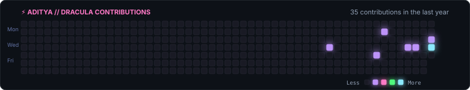

<p align="center">
  
</p>

### 🛠️ Tech Stack & Tooling

```
▶ LANGUAGES
```
<p>
  
  
</p>

```
▶ AI, ML & ROBOTICS
```
<p>
  
  
  
  
</p>

```
▶ TOOLS & PLATFORMS
```
<p>
  
  
  
  
</p>

---

### 📊 Contribution Activity

<p align="center">
  
</p>

---

### 📌 Featured Projects

* **[edgeai-for-beginners](https://github.com/adiityakr/edgeai-for-beginners)** `Jupyter Notebook` / `Python`  
  Comprehensive beginner course & notebooks covering Edge AI models, embedded inference techniques, and intelligent agents.

* **[Hopper](https://github.com/adiityakr/Hopper)** `Python`  
  Python automation and algorithmic execution utility.

* **[Portfolio](https://github.com/adiityakr/Portfolio)** `CSS` / `Web`  
  Personal responsive developer website showcasing work, technical background, and achievements.

---

### 🤝 Let's Connect

<p>
  <a href="https://www.linkedin.com/in/aditya-kumar-4b3018441/" target="_blank">
    
  </a>
  &nbsp;
  <a href="mailto:adityakumar33307@gmail.com">
    
  </a>
  &nbsp;
  
  &nbsp;
  
</p>
